<p align="center">
  
</p>

<p align="center">
  <strong>Your music, flowing across the screen.</strong><br />
  A desktop YouTube Music player with a fullscreen waveform visualizer.
</p>

<p align="center">
  <strong>English</strong> · <a href="README.ko.md">한국어</a>
</p>

<p align="center">
  <a href="license"></a>
  
  <a href="https://www.electronjs.org/"></a>
  <a href="https://www.typescriptlang.org/"></a>
</p>

<p align="center">
  <a href="#features">Features</a> ·
  <a href="#quick-start">Quick start</a> ·
  <a href="#keyboard-shortcuts">Shortcuts</a> ·
  <a href="#contributing">Contributing</a>
</p>

---

Waveflow turns the track you are listening to into a scrolling waveform. Choose a visual style, let your album art set the color, and give the music room to breathe. Search and playlists stay a click away.

Built on [Pear Desktop](https://github.com/pear-devs/pear-desktop), with the player and visualizer together in one repository.

## Features

- **Five visual styles.** Switch between bars, ribbons, layered spectra, live history and dots.
- **Colors from your album art.** Automatic cover colors, plus Sunset, White, Mint, Lilac and Cherry presets.
- **A view that stays clear.** Cover art, track information and controls fade together after three seconds of inactivity while playing. Pointer or keyboard input brings them back; pausing keeps them visible.
- **Browsing within reach.** Open **Search**, **Playlists** or **YouTube Music**, then return with **Back to Waveflow**. Playback and waveform collection continue while you browse.
- **Waveforms that remember.** Save the parts you have heard locally, so repeat listens can show more of a track.
- **Direct control.** Fullscreen viewing, keyboard shortcuts, waveform dragging and zoom, with an English interface set in Pretendard.

### Choose your flow

| Style | Look |
| :--- | :--- |
| **Classic** | Vertical bars with a reflection below the baseline |
| **Ribbon** | A continuous, flowing shape |
| **Spectrum** | Layered bass, midrange and treble bands |
| **Live** | A view of the audio arriving right now |
| **Dots** | The waveform drawn as points |

## Quick start

**Requirements:** Node.js 22.18+ and pnpm 11+.

macOS with Apple Silicon is the currently tested platform. The inherited Intel, Windows and Linux build targets have not been verified for Waveflow.

```sh
git clone https://github.com/choijw1004/waveflow.git
cd waveflow
pnpm install --frozen-lockfile
pnpm dev
```

1. Sign in to YouTube Music in the app.
2. Enable **Waveflow** from the **Plugins** menu.
3. Play a track, then press **W** or click **Back to Waveflow**.

Everything runs from this checkout. No separate Pear Desktop checkout or sync step is needed.

### Move between music and visuals

| Button | Action |
| :--- | :--- |
| **Search** | Open YouTube Music search and focus the search field |
| **Playlists** | Open your YouTube Music playlists |
| **YouTube Music** | Return to the current browsing page |
| **Back to Waveflow** | Return to the visualizer |

### Build a macOS app

```sh
pnpm dist:mac:arm64
```

The app and installer are written to `pack/`:

```text
pack/
├── mac-arm64/Waveflow.app
└── Waveflow-<version>-arm64.dmg
```

The current macOS package uses ad-hoc signing and has not been notarized by Apple. Homebrew distribution is not set up yet; the instructions above build from source.

## Keyboard shortcuts

| Key | Action |
| :--- | :--- |
| <kbd>W</kbd> | Switch between Waveflow and YouTube Music |
| <kbd>Space</kbd> | Play / pause |
| <kbd>1</kbd>–<kbd>5</kbd> | Select a visual style |
| <kbd>C</kbd> | Cycle colors |
| <kbd>M</kbd> | Cycle motion intensity |
| <kbd>F</kbd> | Toggle fullscreen |
| <kbd>/</kbd> | Open search |
| <kbd>P</kbd> | Open playlists |
| <kbd>←</kbd> / <kbd>→</kbd> | Seek backward / forward five seconds |
| <kbd>+</kbd> / <kbd>−</kbd> | Zoom in / out |
| <kbd>Esc</kbd> | Exit fullscreen, then return to YouTube Music |
| Drag the waveform | Seek through the track |

Visualizer shortcuts apply while Waveflow is open. **W** also opens it while browsing, except when you are typing in a field.

<details>
<summary><strong>How waveform history works</strong></summary>

On a first listen, Waveflow collects waveform peaks as the audio plays. Those samples are stored locally in IndexedDB for each track. On repeat listens, saved sections can appear ahead of the current playback position.

Seeking past a section leaves a gap until you listen to it. Waveform history can be disabled or cleared from the Waveflow plugin menu.

</details>

## Development

| Command | Purpose |
| :--- | :--- |
| `pnpm dev` | Run the desktop app in development mode |
| `pnpm test` | Run waveform, branding and UI integration checks |
| `pnpm typecheck` | Check TypeScript types |
| `pnpm build` | Build the Electron main, preload and renderer bundles |
| `pnpm start` | Run the built app |
| `pnpm dist:mac:arm64` | Package the Apple Silicon app and DMG |

<details>
<summary><strong>Repository layout</strong></summary>

```text
src/
├── plugins/waveflow/       Visuals, audio capture, navigation and cache
├── i18n/resources/         Interface strings
├── brand.ts               App identity and window titles
└── ...                    Pear Desktop host
icon/                      App icon and README banner
tests/                     Waveform and branding checks
scripts/check-ui.mjs       UI integration checks
waveflow/reference/        Original visual reference
```

</details>

## Contributing

Bug reports, visual ideas, performance improvements and pull requests are welcome.

- [Open an issue](https://github.com/choijw1004/waveflow/issues) with steps to reproduce a bug or describe your idea.
- For code changes, run `pnpm test` and `pnpm typecheck` before opening a pull request.
- For visual or interaction changes, include a screenshot or short recording and check the behavior in the desktop app.

## Credits & license

Waveflow builds on [Pear Desktop](https://github.com/pear-devs/pear-desktop). The imported host is based on commit [`3337446`](https://github.com/pear-devs/pear-desktop/commit/3337446b448454125ad261099a25f6b10fbb8cb6), and its copyright notice is retained in the [MIT license](license).

The interface uses [Pretendard](https://github.com/orioncactus/pretendard), bundled under the [SIL Open Font License](src/plugins/waveflow/assets/Pretendard-LICENSE.txt).

---

<p align="center">
  <a href="https://github.com/choijw1004/waveflow">Source</a> ·
  <a href="https://github.com/choijw1004/waveflow/issues">Issues</a> ·
  <a href="README.ko.md">한국어로 읽기</a>
</p>
